# SentinelCore

### A self-hosted network detection and incident response workspace

SentinelCore brings network visibility, alert investigation, incident triage, and guarded response into one place. It watches traffic visible to a Suricata sensor, turns detections into searchable events, connects related activity, and gives an analyst the evidence and controls needed to respond.

> **Status:** SentinelCore is a security engineering project intended for authorized labs and networks you operate. The screenshots below show real application screens. Some are empty-state views; displayed data depends on the configured sensor, feeds, and network traffic.

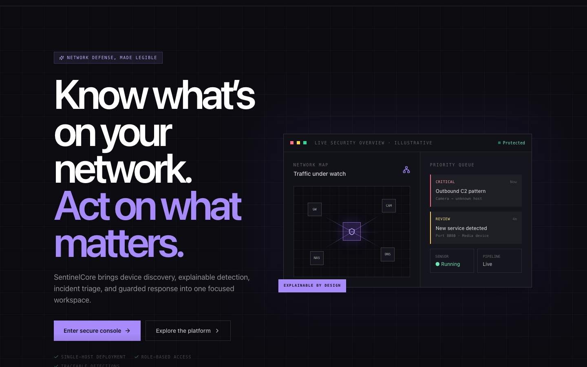

<p align="center"><em>The landing page introduces the visibility-to-response workflow.</em></p>

---

## What SentinelCore does

Most small network environments have separate tools for device inventory, IDS alerts, packet captures, block lists, and reports. SentinelCore puts those workflows into a single self-hosted console:

1. **Discover** hosts and exposed services on an explicitly configured network.
2. **Inspect** mirrored traffic with Suricata and collect its explainable detections.
3. **Search** normalized events by time, severity, signature, protocol, address, and related fields.
4. **Correlate** related behavior into incident candidates using readable, rule-based logic.
5. **Investigate** incidents with linked events, evidence, ownership, status, and history.
6. **Respond** with expiring firewall blocks that have guard checks and an audit trail.
7. **Report** on incidents, assets, and event activity; configure scheduled reports.
8. **Enrich** live traffic and uploaded captures with known-bad indicators.

SentinelCore is designed to make the path from signal to action reviewable. It does not make an automatic detection decision with a black-box model: alerts trace back to a Suricata signature or a correlation rule. Containment remains an explicit analyst action.

## Product tour

### At a glance

The overview brings attention items, sensor health, event rates, and recent high-severity signals into one dashboard.

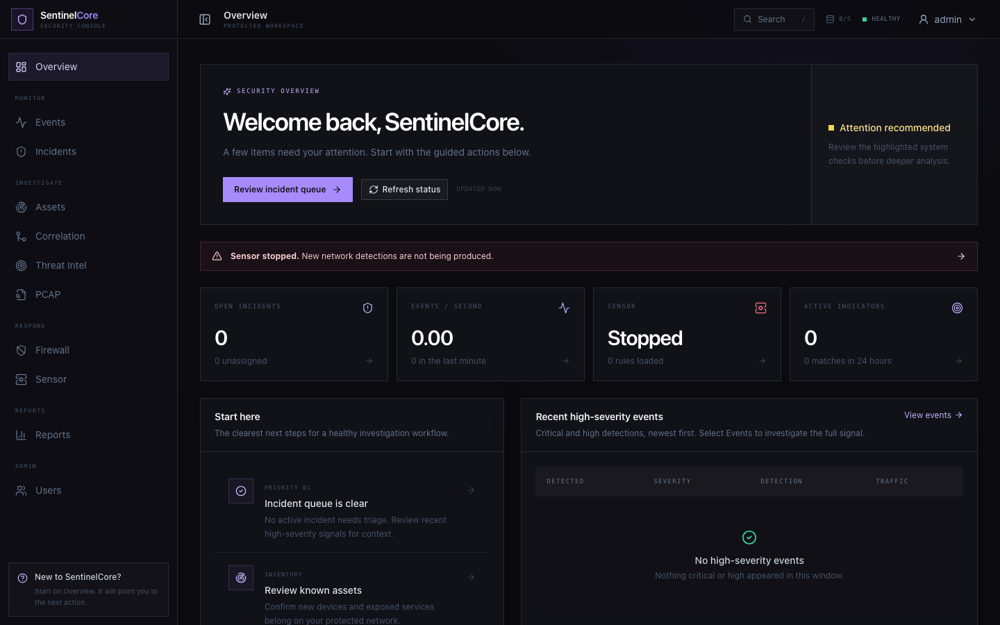

### Inventory and sensor health

Asset discovery records hosts and observed services. The sensor page shows Suricata lifecycle, rules, throughput, packet drops, and rule sources.

| Asset inventory | Sensor operations |
|---|---|
| 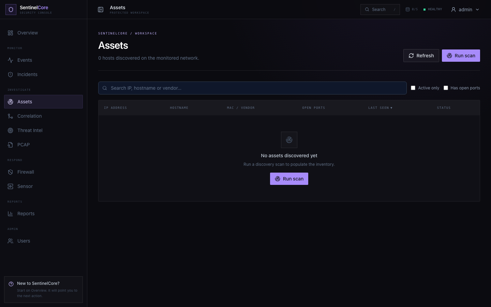 | 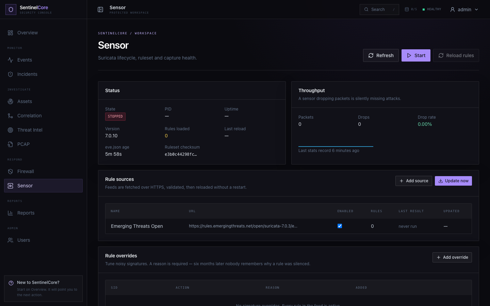 |

### Events, correlation, and incident response

Investigators can filter the event stream, inspect facets, and use saved searches. Correlation rules group related events into candidates. Analysts can promote candidates into incidents, assign ownership, work through triage states, attach evidence, and review activity history.

| Event search | Correlation rules |
|---|---|
| 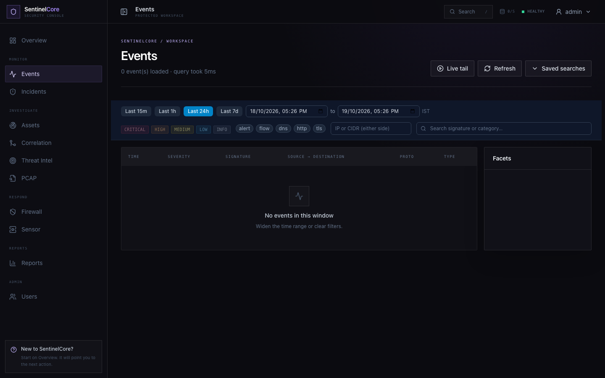 | 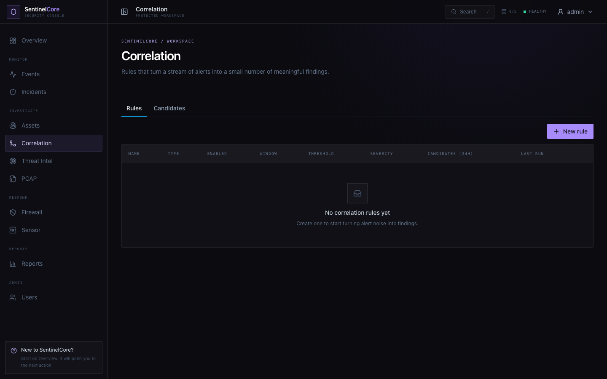 |

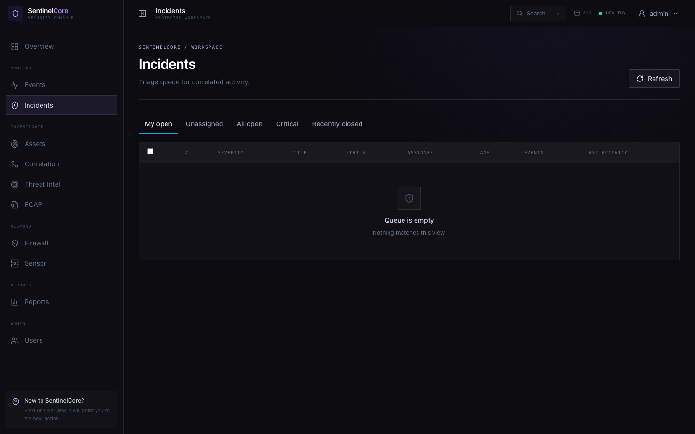

<p align="center"><em>Incident queue with ownership and triage views.</em></p>

### Guarded containment and threat intelligence

Firewall blocks require a time-to-live and automatically expire. Protected addresses are checked before a block is applied. Threat intelligence supports indicators of compromise, feed sources, matches against observed activity, and retroactive searches.

| TTL-bounded firewall controls | Indicator management |
|---|---|
| 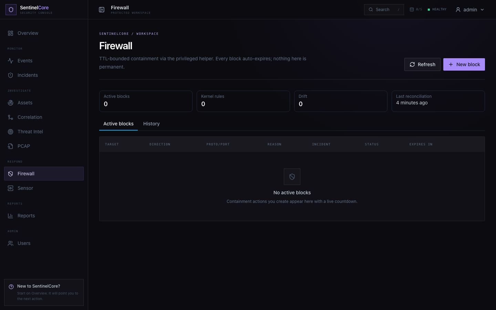 | 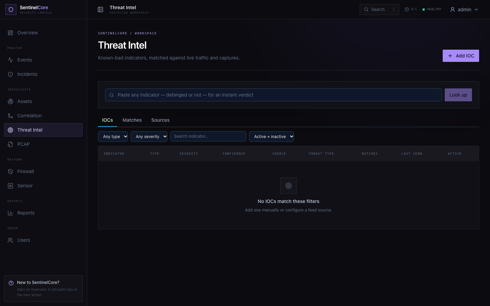 |

### Reports and access

Generate incident, asset inventory, and event statistics reports in supported formats, or manage report schedules. Role-based access separates read-only work, analyst investigation, and administrative controls.

| Reports | Sign in |
|---|---|
| 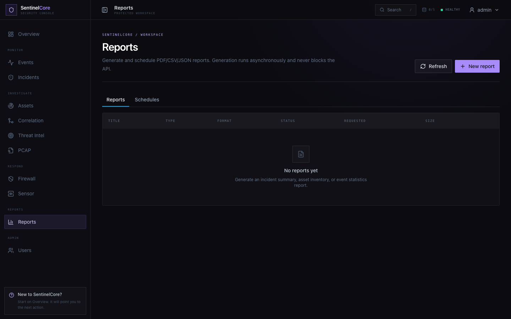 | 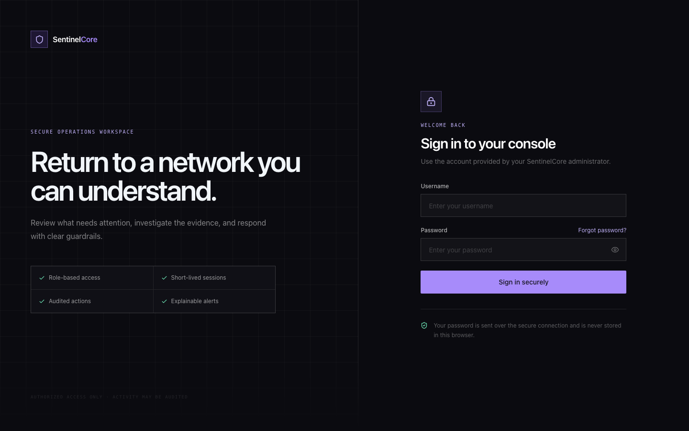 |

## How the system fits together

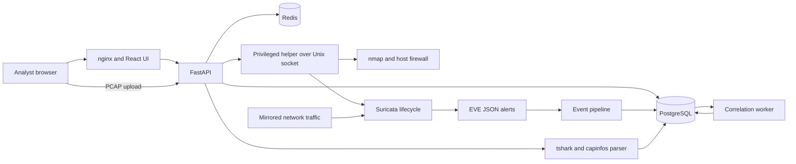

The API and web application handle normal workspace requests. Operations that need host-level privileges cross a narrow Unix-socket interface to a dedicated helper. The backend itself runs without raw-socket or netfilter capabilities. PCAP parsing runs in the unprivileged backend and does not pass captures to that helper.

## Features in detail

| Area | What it provides |
|---|---|
| Authentication | Login, short-lived sessions, password reset flows, and role-aware route access. |
| Assets | Authorized network discovery, host and port inventory, scan history, and asset details. |
| Sensor | Suricata status and controls, ruleset sources, rule overrides, throughput, and drop visibility. |
| Event pipeline | EVE ingestion, normalization, deduplication, and searchable event storage. |
| Event search | Time windows, severity and protocol filters, address and signature search, facets, and saved searches. |
| Correlation | Rule-driven thresholds, sequences, rare activity, and beacon-like patterns with reviewable candidates. |
| Incidents | Candidate promotion, assignment, triage, evidence links, state history, and investigation workflow. |
| PCAP analysis | Upload and analyze captures, inspect flows and packets, and review extracted artifacts. |
| Threat intelligence | IOC management, feed ingestion, live matching, and retro-hunts. |
| Firewall | Explicit TTL-bounded blocks, protected-address checks, reconciliation, and audit records. |
| Reports | Incident, inventory, and event statistics output with scheduled generation support. |
| Administration | User and role management plus operational controls for authorized administrators. |

Feature notes and implementation reports are collected in [`docs/modules/`](docs/modules/). See the [threat model](docs/threat-model.md), [test report](docs/test-report.md), and [validation notes](docs/validation-results.md) for additional detail.

## Security and operating boundaries

- **Authorized networks only.** Discovery scans, packet capture, and containment must only be used on networks and hosts you own or have explicit permission to administer.
- **Privilege separation.** The API does not receive `NET_ADMIN` or `NET_RAW`. A dedicated helper accepts validated requests over a Unix socket for the small set of operations that require host privileges.
- **Expiring blocks.** Firewall actions require a bounded TTL; permanent blocks are not part of the workflow. Protected IPs are rejected independently of the UI.
- **Auditable writes.** Administrative and response actions are recorded. The database audit log uses append-only protections and a hash chain for tamper evidence.
- **Explainable detections.** The source signature or correlation rule remains available for investigation.
- **Self-hosted data path.** The supplied deployment keeps application data in the environment where you run it. External IOC feeds are contacted only when configured.

Read the full [threat model](docs/threat-model.md) before deploying this system outside a lab.

## Technology

- **Frontend:** React, Vite, Tailwind CSS
- **API:** Python and FastAPI
- **Persistence and jobs:** PostgreSQL and Redis
- **Network detection:** Suricata EVE JSON
- **Packet capture analysis:** `tshark` and `capinfos`
- **Deployment:** Docker Compose, nginx, and a dedicated privileged helper

## Run it in an authorized lab

The complete source repository is separate from this documentation repository. The deployment expects a Linux host with Docker Engine and Docker Compose v2, plus a traffic interface configured to observe the network you are authorized to monitor. A mirrored or promiscuous interface is required for meaningful Suricata inspection.

In the source repository:

```bash
cp .env.example .env
# Edit .env: set strong POSTGRES_PASSWORD and SECRET_KEY values,
# CAPTURE_INTERFACE, MONITORED_NETWORK, and PROTECTED_IPS.
npm run dev
```

Open `http://localhost/` after startup. The first administrator account is seeded during backend startup. Set its password through the documented environment configuration; do not publish local credentials or `.env` files.

Useful commands from the source checkout:

```bash
npm run dev:status
npm run dev:logs
npm run dev:restart
npm run dev:rebuild
npm run dev:stop
npm run build
```

This docs repository does not contain the full application source, container images, or a hosted service. Do not point scans or firewall actions at a third-party, school, or employer network without written authorization.

## Documentation index

- [Asset discovery](docs/modules/assets.md)
- [Suricata sensor](docs/modules/sensor.md)
- [Event pipeline](docs/modules/event-pipeline.md)
- [Event search](docs/modules/event-search.md)
- [Correlation](docs/modules/correlation.md)
- [Incident management](docs/modules/incidents.md)
- [Reporting](docs/modules/reporting.md)
- [Firewall containment](docs/modules/firewall.md)
- [PCAP analysis](docs/modules/pcap.md)
- [Threat intelligence](docs/modules/threat-intel.md)
- [Threat model](docs/threat-model.md)
- [Test report](docs/test-report.md)
- [Validation criteria](docs/validation-criteria.md) and [results](docs/validation-results.md)
- [Performance results](docs/performance-results.md)

## Team and license

Developed by Dhruv Patel and Nisarg Dedakiya. This project does not currently include an open-source license. Until a license is added by the maintainers, all rights are reserved; public access to this documentation does not grant permission to copy, modify, or redistribute the software.
